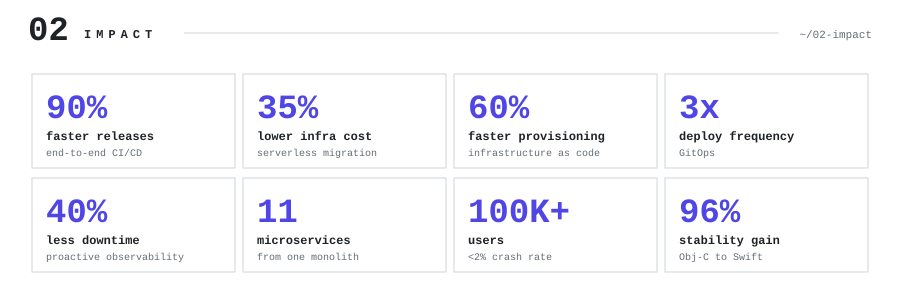
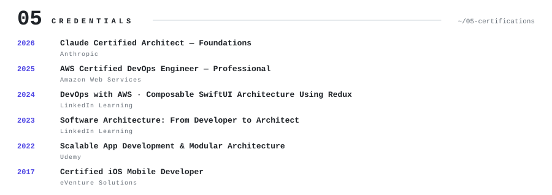
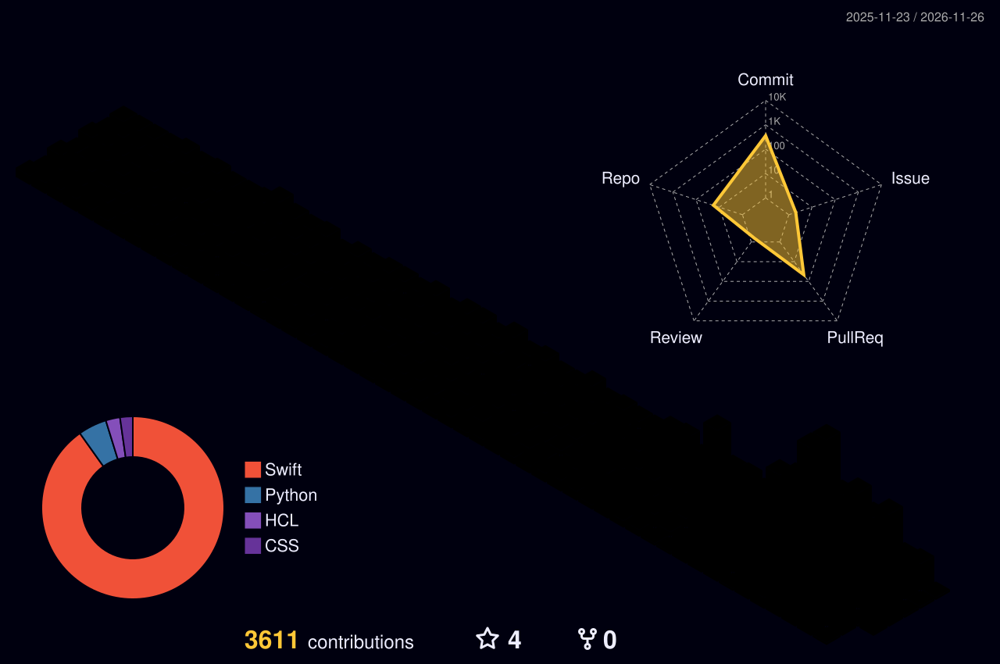

<!-- Terminal-style panels are generated: edit assets/build.py, run `python3 assets/build.py` -->

<picture>
  <source media="(prefers-color-scheme: dark)" srcset="assets/dark/header.svg">
  
</picture>

  
  
  
  
  
  
  

<picture>
  <source media="(prefers-color-scheme: dark)" srcset="assets/dark/whoami.svg">
  
</picture>

<picture>
  <source media="(prefers-color-scheme: dark)" srcset="assets/dark/impact.svg">
  
</picture>

<picture>
  <source media="(prefers-color-scheme: dark)" srcset="assets/dark/projects.svg">
  
</picture>

<picture>
  <source media="(prefers-color-scheme: dark)" srcset="assets/dark/opensource.svg">
  
</picture>

  <a href="https://github.com/ihusnainalii/SwiftNetworkKit">SwiftNetworkKit</a> &nbsp;·&nbsp;
  <a href="https://github.com/ihusnainalii/SwiftLocalStorage">SwiftLocalStorage</a> &nbsp;·&nbsp;
  <a href="https://github.com/ihusnainalii/LocalConsoleSwift">LocalConsoleSwift</a>

<picture>
  <source media="(prefers-color-scheme: dark)" srcset="assets/dark/stack.svg">
  
</picture>

<picture>
  <source media="(prefers-color-scheme: dark)" srcset="assets/dark/certs.svg">
  
</picture>

<picture>
  <source media="(prefers-color-scheme: dark)" srcset="assets/dark/activity.svg">
  
</picture>

  <picture>
    <source media="(prefers-color-scheme: dark)" srcset="https://github-readme-streak-stats.herokuapp.com/?user=ihusnainalii&hide_border=true&background=00000000&stroke=30363D&ring=22D3EE&fire=22D3EE&currStreakNum=22D3EE&sideNums=E6EDF3&currStreakLabel=22D3EE&sideLabels=9198A1&dates=9198A1">
    
  </picture>

  <picture>
    <source media="(prefers-color-scheme: dark)" srcset="https://github-readme-activity-graph.vercel.app/graph?username=ihusnainalii&hide_border=true&area=true&bg_color=00000000&custom_title=Contributions%2C%20last%2031%20days&color=9198A1&line=22D3EE&point=E6EDF3&area_color=22D3EE&title_color=22D3EE">
    
  </picture>

  <picture>
    <source media="(prefers-color-scheme: dark)" srcset="https://raw.githubusercontent.com/ihusnainalii/ihusnainalii/output/github-snake-dark.svg" />
    <source media="(prefers-color-scheme: light)" srcset="https://raw.githubusercontent.com/ihusnainalii/ihusnainalii/output/github-snake.svg" />
    
  </picture>

  

  <picture>
    <source media="(prefers-color-scheme: dark)" srcset="https://trophygithubreadmelang.cybee.dpdns.org/?username=ihusnainalii&theme=darkhub&no-bg=true&no-frame=true&column=4&margin-w=10&margin-h=10&title=MultiLanguage,Repositories,Commits,Experience,PullRequest,Stars,Followers,Issues">
    
  </picture>

<picture>
  <source media="(prefers-color-scheme: dark)" srcset="assets/dark/writing.svg">
  
</picture>

<!-- BLOG-POST-LIST:START -->
- [SwiftNetworkKit: A Swift 6 Networking Layer You Don’t Have to Rebuild Every App](https://medium.com/@husnainali593/swiftnetworkkit-a-swift-6-networking-layer-you-dont-have-to-rebuild-every-app-a9ae4e2b1020?source=rss-ffca6b2fe6a6------2)
- [I Started as a Mobile Developer. Then I Learned to Engineer the Entire System](https://medium.com/@husnainali593/i-started-as-a-mobile-developer-then-i-learned-to-engineer-the-entire-system-75b6498cca18?source=rss-ffca6b2fe6a6------2)
- [LocalConsoleSwift: A Swift 6 On-Device Debug Console for iOS](https://medium.com/@husnainali593/localconsoleswift-a-swift-6-on-device-debug-console-for-ios-24fdc80ac0e2?source=rss-ffca6b2fe6a6------2)
- [Understanding MongoDB Data Sync: Replica Sets, Oplogs, and Elections](https://medium.com/@husnainali593/understanding-mongodb-data-sync-replica-sets-oplogs-and-elections-f07522b242a8?source=rss-ffca6b2fe6a6------2)
- [Write Concern in MongoDB: What It Is, Why It Matters, and What to Use in Production](https://medium.com/@husnainali593/write-concern-in-mongodb-what-it-is-why-it-matters-and-what-to-use-in-production-ef52008a6f64?source=rss-ffca6b2fe6a6------2)
<!-- BLOG-POST-LIST:END -->

<picture>
  <source media="(prefers-color-scheme: dark)" srcset="assets/dark/footer.svg">
  
</picture>
